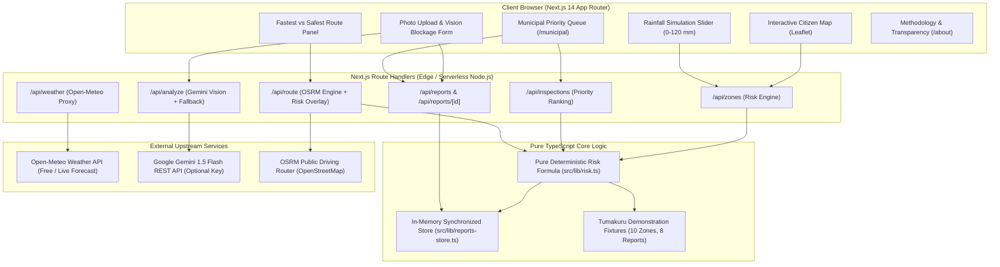

# PROJECT CONTEXT: DrainGuard 🛡️🌧️

> **Portable Master Context Document**  
> *Purpose:* Paste or provide this document to any LLM/AI model or assistant to provide instant, complete context on what DrainGuard is, why it was created, how its architecture and algorithms work, its codebase structure, and how to operate or extend it.

---

## 1. Executive Summary & "The Why" (Problem Statement)

### Problem
In urban India (and many Global South cities), torrential monsoon showers routinely cause severe urban inundation within 30–60 minutes. 
- **Commuters** only discover that an underpass or arterial road is inundated when they are already stranded in bumper-to-bumper waterlogging.
- **Municipal Authorities** operate purely reactively, addressing citizen grievances sequentially (first-come, first-served) rather than dispatching teams proactively to high-risk catchments before the rain peaks.
- **Existing Flood Models** are often "black boxes" lacking explainability, require expensive sensor infrastructure that most municipalities lack, or provide macro-level regional alerts that lack street-level actionability.

### Solution: DrainGuard
DrainGuard is an **explainable, sensor-free, hyper-local urban waterlogging intelligence system** built for Indian municipal corporations (specifically piloted for Tumakuru City Corporation, Karnataka) and urban commuters.

1. **Deterministic Risk Scoring (0–100)**: Combines live Open-Meteo rainfall forecasts, elevation depression factors, historical waterlogging frequency, and verified citizen blockage reports into an explainable, auditable score.
2. **Citizen Reporting with Vision AI**: Residents upload photos of clogged drains. Multimodal AI (Google Gemini 1.5 Flash with automatic deterministic fallback) identifies blockage type and severity.
3. **Smart Flood Routing (Fastest vs. Safest)**: Computes driving routes via OSRM and evaluates intersection with waterlogging risk zones, offering safer detours to avoid flooded choke points.
4. **Municipal Prioritized Clearance Queue**: Replaces reactive grievance redressal with a deterministic priority dispatch dashboard (`score DESC → open_reports DESC`), allowing municipalities to clear bottlenecks *before* rainfall crests.

---

## 2. "The How": Architecture & Tech Stack



### Core Technologies
- **Frontend / Fullstack**: Next.js 14 (App Router), React 18, TypeScript 5.6
- **Styling**: Tailwind CSS 3.4 (Custom DrainGuard theme: Deep Navy `#0F172A`, Electric Blue `#0EA5E9`, Hazard Coral `#F43F5E`, etc.)
- **Maps & Cartography**: Leaflet 1.9, React-Leaflet 4.2, OpenStreetMap
- **Spatial Geo-Computation**: `@turf/turf` 7.4 (Point-in-polygon, buffer queries, line-zone intersections)
- **Validation**: Zod 3.23 (strictly typed request/response schemas)
- **Testing**: Vitest 2.1 (40+ unit and integration test suite)

---

## 3. Mathematical Risk Engine (Auditable & Explainable)

DrainGuard does **not** use an uninterpretable machine learning black-box for flood risk. Instead, it computes an auditable deterministic score:

### Raw Risk Formula:
$$\text{RawScore} = 100 \times \Big( 0.40 \cdot \text{rain} + 0.25 \cdot \text{blockage} + 0.20 \cdot \text{history} + 0.15 \cdot \text{elevation} \Big)$$

### Factor Normalization:
1. **$\text{rain}$** $\in [0, 1]$:
   $$\text{rain} = \min\left(\frac{\text{rain\_mm}}{60}, 1.0\right)$$
2. **$\text{blockage}$** $\in [0, 1]$:
   Aggregated from citizen reports in the zone:
   $$\text{blockage} = \min\left(\frac{\sum (\text{severity} \times w_{\text{status}})}{6}, 1.0\right)$$
   Where:
   - $w_{\text{open}} = 1.0$
   - $w_{\text{assigned}} = 0.5$
   - $w_{\text{cleared}} = 0.0$
   - $\text{severity} \in \{1, 2, 3\}$
3. **$\text{history}$** $\in [0, 1]$: Zone-specific historical ponding frequency.
4. **$\text{elevation}$** $\in [0, 1]$: Inverted elevation / depression factor (higher means lower-lying / basin).

### Rainfall Physical Gating:
Urban street flooding is physically governed by rainfall. If total rainfall is $< 5\text{ mm}$, the raw score is attenuated by $0.3$:
$$\text{FinalScore} = \begin{cases} \text{round}(\text{RawScore} \times 0.3) & \text{if } \text{rain\_mm} < 5 \\ \text{round}(\text{RawScore}) & \text{if } \text{rain\_mm} \ge 5 \end{cases}$$

### Risk Categorization:
| Score Band | Category | Color Hex | Meaning / Action |
|---|---|---|---|
| **0 – 29** | Low | Green (`#22C55E`) | Normal drainage flow; safe |
| **30 – 59** | Medium | Amber (`#F59E0B`) | Moderate ponding; two-wheeler caution |
| **60 – 79** | High | Coral (`#F97316`) | Significant ponding; avoid low-lying roads |
| **80 – 100** | Severe | Crimson (`#EF4444`) | Road inundated; deploy municipal pumps |

---

## 4. Key Subsystems & Features

### 1. Vision AI Blockage Classifier (`src/lib/vision.ts`)
- Accepts citizen drain photos (Base64 JPEG/PNG).
- Prompts **Google Gemini 1.5 Flash** to extract:
  - `debris_type`: `'plastic' | 'silt' | 'debris' | 'construction' | 'none' | 'unknown'`
  - `estimated_severity`: `1 | 2 | 3`
  - `confidence`: `0.0 – 1.0`
  - `summary`: One sentence description
- **Zero-Downtime Deterministic Fallback**: If `GEMINI_API_KEY` is missing or upstream times out, it uses a deterministic hash fallback to guarantee seamless UI demos and test passes without crashing.

### 2. Fastest vs. Safest Routing (`src/lib/routing.ts`)
- Queries OpenStreetMap / OSRM public routing API for alternative paths between user source and destination.
- Buffers the route polyline (30 meters) using `@turf/turf`.
- Checks intersection with high-risk/severe polygons (`score >= 60`).
- If the fastest route intersects high-risk zones, DrainGuard computes and highlights the **Safest Detour**, showing risk delta and travel time difference.

### 3. Municipal Operations Dashboard (`/municipal`)
- Aggregates all catchments into a prioritized work queue:
  `ORDER BY risk_score DESC, open_reports DESC, zone_id ASC`
- Dispatch workflow: municipal supervisors can click an active report and transition its status:
  `open` ➔ `assigned` ➔ `cleared`
- Updating a report immediately triggers live recalculation of the zone's blockage factor and risk score.

### 4. Interactive Simulation & Weather Sync
- **Live Mode**: Fetches real-time precipitation forecast for Tumakuru (`13.3409°N, 77.1010°E`) from Open-Meteo.
- **Simulation Slider**: 0 to 120 mm/hr allows municipal planners and hackathon judges to simulate flash flood scenarios in real-time.

---

## 5. Repository File Structure

```
DrainGuard/
├── docs/                           # Comprehensive specifications
│   ├── 01_PROBLEM_STATEMENT.md
│   ├── 02_PRD.md
│   ├── 03_ARCHITECTURE.md
│   ├── 04_DATA_MODEL.md
│   ├── 05_RISK_ENGINE.md
│   ├── 06_API_SPEC.md
│   ├── 07_UI_UX_SPEC.md
│   └── ...
├── src/
│   ├── app/                        # Next.js App Router
│   │   ├── layout.tsx              # Root HTML & metadata
│   │   ├── page.tsx                # Citizen Portal (Map, Slider, Form, Route)
│   │   ├── municipal/page.tsx      # Municipal Dispatch Dashboard
│   │   ├── about/page.tsx          # Methodology & Transparency Formula page
│   │   ├── globals.css             # Tailwind & Leaflet styling overrides
│   │   └── api/                    # Serverless API Handlers
│   │       ├── analyze/route.ts    # Gemini Vision analysis endpoint
│   │       ├── inspections/route.ts# Prioritized municipal queue endpoint
│   │       ├── reports/            # Citizen report creation & status updates
│   │       ├── route/route.ts      # OSRM risk-weighted routing endpoint
│   │       ├── weather/route.ts    # Open-Meteo forecast proxy
│   │       └── zones/route.ts      # Zone risk calculation endpoint
│   ├── components/                 # UI Components
│   │   ├── Header.tsx              # Brand navigation & mode switcher
│   │   ├── MapView.tsx             # Interactive Leaflet map (client-only dynamic)
│   │   ├── MapWrapper.tsx          # SSR boundary wrapper for Leaflet
│   │   ├── RainSlider.tsx          # Rainfall controller & live weather sync
│   │   ├── ReportForm.tsx          # Citizen drain reporting modal with preview
│   │   ├── RoutePanel.tsx          # Fastest vs Safest routing UI
│   │   └── ZonePanel.tsx           # Zone details & report inspection drawer
│   ├── data/                       # Seed Fixtures (Tumakuru, Karnataka)
│   │   ├── zones.seed.json         # 10 GeoJSON polygons with elevation/history
│   │   └── reports.seed.json       # 8 Pre-seeded citizen blockage reports
│   └── lib/                        # Core Domain & Utility Logic
│       ├── config.ts               # Env vars & city defaults (Tumakuru)
│       ├── reports-store.ts        # In-memory synchronized CRUD state
│       ├── risk.ts                 # Pure risk score calculation & gating
│       ├── routing.ts              # OSRM + Turf.js spatial intersection engine
│       ├── types.ts                # TypeScript interfaces & Zod schemas
│       ├── vision.ts               # Gemini API client + heuristic fallback
│       └── weather.ts              # Open-Meteo forecast parser
├── tests/                          # Automated Vitest test suites
├── package.json                    # Dependencies & scripts
├── tailwind.config.ts              # Theme tokens & custom colors
├── tsconfig.json                   # Strict TypeScript compiler options
└── vitest.config.ts                # Test runner configuration
```

---

## 6. API Reference Summary

| Endpoint | Method | Description |
|---|---|---|
| `/api/zones?rain_mm=X` | `GET` | Computes risk scores (0–100) and factors for all 10 zones. |
| `/api/weather` | `GET` | Returns live precipitation, temperature, and wind from Open-Meteo. |
| `/api/reports` | `GET` | Returns list of all citizen blockage reports. |
| `/api/reports` | `POST` | Submits a new report (zone ID, lat/lon, severity, debris, photo). |
| `/api/reports/[id]` | `PATCH` | Updates report status (`open` ➔ `assigned` ➔ `cleared`). |
| `/api/analyze` | `POST` | Sends drain photo to Gemini Vision to classify debris & severity. |
| `/api/inspections?rain_mm=X` | `GET` | Returns zones ranked by municipal clearance priority. |
| `/api/route` | `POST` | Takes start/end lat/lon, returns Fastest and Safest routes with risk stats. |

---

## 7. Development & Runtime Guidelines for AI Agents

1. **Hydration / SSR Safety**: Leaflet depends directly on `window` and the DOM. Any map component must be rendered with `dynamic(() => import(...), { ssr: false })` using `MapWrapper.tsx`.
2. **Determinism in Tests**: Core risk scoring in `src/lib/risk.ts` must remain pure functions without side-effects or external network calls so tests can run in milliseconds in any sandbox.
3. **Graceful Fallbacks**: Any external call (`Gemini`, `Open-Meteo`, `OSRM`) must always have a fallback mechanism to prevent UI breakage during offline demoing or API rate limiting.
4. **Coordinate System**: All geographic operations use `[lat, lon]` (Leaflet format) or `[lon, lat]` (GeoJSON/Turf format). Pay close attention when converting between Turf and Leaflet coordinates.
