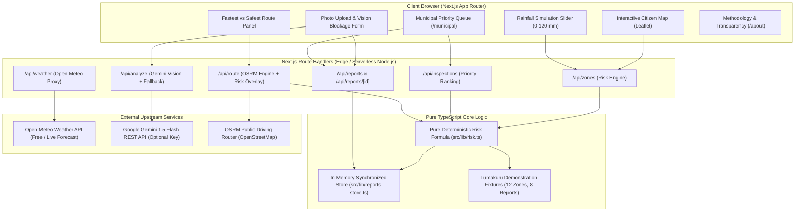

# DrainGuard 🛡️🌧️

> **Core2Code 2K26 — Smart City & Urban Innovation Hackathon**  
> Organized by **IEEE SIT Student Branch** & **IEEE Computer Society**  
> *Deadline: 10:00 AM IST, October 25, 2026*

[](https://nextjs.org/)
[](https://www.typescriptlang.org/)
[](https://tailwindcss.com/)
[](https://vitest.dev/)
[](./LICENSE)

---

## 📌 Problem & Pitch

In urban India during torrential monsoon showers, commuters find out an underpass or arterial road is inundated only when they are already stuck in bumper-to-bumper waterlogging. Meanwhile, municipal drainage and storm-water maintenance crews react sequentially to citizen phone complaints in the order received, rather than dispatching teams proactively to high-risk catchments before the rain peaks.

**DrainGuard** provides:
1. **Explainable Zone-Level Waterlogging Risk**: Street-by-street risk scoring (0–100) combining live Open-Meteo rainfall forecasts, elevation profiles, terrain slope, drainage capacity, historical hotspots, and citizen-reported blockages.
2. **Citizen Drain Reporting with Vision AI**: Residents upload photos of blocked drains; Gemini Vision classifies the debris and severity with zero-downtime deterministic fallback.
3. **Fastest vs. Safest Routing**: Evaluates OpenStreetMap/OSRM driving routes against live flooded zones, offering safer detours that bypass high-risk choke points.
4. **Municipal Prioritized Inspection Queue**: Ranks drainage catchments by immediate clearance priority, enabling proactive workforce dispatch and live report lifecycle management (Open → Assigned → Cleared).

---

## 🗺️ System Architecture



---

## 🧮 Explainable Risk Model

DrainGuard rejects uninterpretable "black box" flood models. Risk scores are completely deterministic, auditable, and mathematically calculated:

$$\text{BaseRisk} = (0.28 \times N_{\text{rain}}) + (0.22 \times N_{\text{elev}}) + (0.16 \times N_{\text{hist}}) + (0.14 \times N_{\text{slope}}) + (0.12 \times N_{\text{block}}) + (0.08 \times N_{\text{cap}})$$

### Rainfall Gating
Urban street flooding is physically governed by rainfall. If rainfall is zero or minimal, risk is strictly capped:
- $\text{rain} = 0 \text{ mm}$: $\text{FinalRisk} = \min(\text{BaseRisk}, 12)$
- $0 < \text{rain} < 5 \text{ mm}$: $\text{FinalRisk} = \min(\text{BaseRisk}, 25)$
- $5 \le \text{rain} < 15 \text{ mm}$: $\text{FinalRisk} = \min(\text{BaseRisk}, 45)$
- $\text{rain} \ge 15 \text{ mm}$: $\text{FinalRisk} = \text{BaseRisk}$ (No gating)

### Severity Tiers
- **Low (0–29)**: Normal drainage function.
- **Moderate (30–49)**: Minor ponding; cautious driving.
- **High (50–69)**: Water accumulation; two-wheelers and sedans advised to avoid.
- **Severe (70–100)**: Critical submergence risk; road closure / emergency clearing recommended.

*Inspect the complete mathematical derivation and factor breakdown in [`src/lib/risk.ts`](./src/lib/risk.ts) and on the [`/about`](./src/app/about/page.tsx) page.*

---

## ✨ Features Implemented & Verified

- [x] **Interactive Citizen Map**: Leaflet map focused on Tumakuru, Karnataka, displaying 12 ward drainage zones with dynamic risk-colored polygons (Green / Yellow / Amber / Red) and pulsing incident beacons.
- [x] **Live Rainfall Simulation**: Synchronized slider (0–120 mm/h) with live Open-Meteo fallback preset buttons (`0mm Clear`, `15mm Moderate`, `45mm Heavy`, `85mm Extreme`).
- [x] **Photo Drain Inspection with Vision AI**: Citizens can upload photos or select sample test images. Gemini 1.5 Flash classifies blockage type, estimated severity, and recommended actions. If no API key is provided or the upstream service fails, an instant deterministic fallback triggers automatically.
- [x] **Fastest vs. Safest Routing**: Computes driving directions using OSRM; if the fastest route passes through High or Severe zones, DrainGuard suggests a safer detour whenever an alternative geometry exists.
- [x] **Municipal Operations Dashboard (`/municipal`)**: Real-time table sorting catchments by municipal priority:
  $$\text{Priority} = (0.55 \times \text{Risk}) + (0.25 \times \text{OpenReports}) + (0.12 \times \text{Vulnerability}) + (0.08 \times \text{ClearanceUrgency})$$
  Features live report status transitions: `OPEN` → `ASSIGNED` → `CLEARED`.
- [x] **Methodology & Transparency (`/about`)**: Complete honest disclosure of formula weights, normalization curves, data limitations, and simulated boundaries.

---

## 💻 Tech Stack

- **Framework**: [Next.js 14](https://nextjs.org/) (App Router, React 18, TypeScript 5)
- **Styling**: [Tailwind CSS](https://tailwindcss.com/) with official DrainGuard brand color tokens
- **Mapping**: [Leaflet 1.9](https://leafletjs.com/) & [React-Leaflet 4.2](https://react-leaflet.js.org/) with OpenStreetMap cartography
- **Spatial Analysis**: [@turf/turf 7.2](https://turfjs.org/) (point-in-polygon, buffer queries, line-zone intersections)
- **Validation**: [Zod 3.23](https://zod.dev/) for strict schema validation across all API endpoints
- **Testing**: [Vitest 2.1](https://vitest.dev/) with 40 unit and integration tests
- **External Integrations**:
  - Weather: Open-Meteo REST API (public, no key required)
  - Vision AI: Google Gemini 1.5 Flash REST API (server-side with mock fallback)
  - Routing: OSRM OpenStreetMap Public Router (with fallback mock routing)

---

## 🚀 Quickstart & Local Setup

### Prerequisites
- Node.js 18.18+ or Node.js 20+
- npm 9+

### 1. Clone & Install
```bash
git clone https://github.com/saugat2737/DrainGuard.git
cd DrainGuard
npm install
```

### 2. Configure Environment Variables
Copy `.env.example` to `.env.local`:
```bash
cp .env.example .env.local
```
*(Optional)* Add your Gemini API key to `.env.local` to enable live Vision AI. If left blank, the built-in deterministic classification fallback operates automatically without crashing:
```env
GEMINI_API_KEY=your_gemini_api_key_here
```

### 3. Run Development Server
```bash
npm run dev
```
Open [http://localhost:3000](http://localhost:3000) in your browser.

### 4. Run Test Suite & Build Verification
```bash
# Run unit & API integration tests (40 tests)
npm test

# Run ESLint check
npm run lint

# Run TypeScript typecheck
npm run typecheck

# Build for production
npm run build
```

---

## ⚖️ Honest Limitations & Disclosures

In accordance with hackathon integrity guidelines:
1. **Simulated Urban Fixtures**: The 12 catchment zones and 8 seed blockage reports in Tumakuru are demonstration fixtures designed for Core2Code 2K26. They are not certified by the Tumakuru City Corporation (TCC).
2. **Rule-Based Risk Model**: The risk score is an explainable weighted heuristic; it is not a calibrated hydrodynamic 2D flood simulation model.
3. **In-Memory Volatility**: Citizen-submitted reports and status transitions are maintained in server memory. On multi-region or cold-started serverless deployments (such as Vercel), in-memory states reset upon instance recycling. In production, this layer connects directly to PostgreSQL / Supabase.
4. **Third-Party Rate Limits**: Routing and live weather rely on public free tiers (OSRM & Open-Meteo) and gracefully fall back to local models if rate limits or network dropouts occur.

---

## 👥 Credits & Acknowledgments

- **Hackathon Organizers**: Core2Code 2K26, IEEE SIT Student Branch, and IEEE Computer Society.
- **Data & Cartography**: [OpenStreetMap](https://www.openstreetmap.org/) contributors, [CARTO](https://carto.com/) base tiles, [Open-Meteo](https://open-meteo.com/), and [Project OSRM](https://project-osrm.org/).
- **AI Vision**: Google Gemini 1.5 Flash API.
