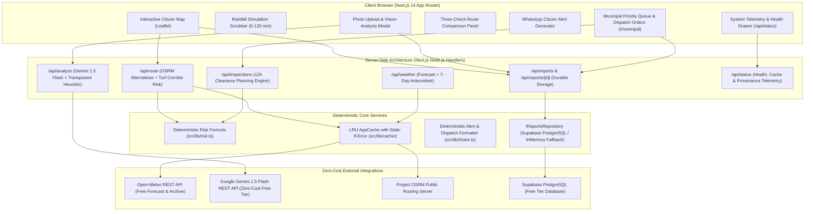

# DrainGuard 🛡️🌧️
### Explainable, Sensor-Free Urban Waterlogging Intelligence & Resilient Routing Platform

> **Core2Code 2K26 — Smart City & Urban Innovation Hackathon**  
> Organized by **IEEE SIT Student Branch** & **IEEE Computer Society**  
> Demonstration City: **Tumakuru, Karnataka, India**

[](https://github.com/saugat2737/DrainGuard/actions)
[](https://nextjs.org/)
[](https://www.typescriptlang.org/)
[](https://tailwindcss.com/)
[-brightgreen?logo=vitest)](https://vitest.dev/)
[](#zero-cost-public-tier-architecture)
[](./LICENSE)
[](./docs/README.md)

---

## 📌 Executive Summary & Problem

During torrential Indian monsoon showers, commuters discover that an arterial road or underpass is inundated only when they are already stranded in bumper-to-bumper traffic. Meanwhile, municipal storm-water engineers and desilting crews react sequentially to citizen phone complaints in the order received, rather than preemptively clearing high-vulnerability choke points before the rain peaks.

**DrainGuard** delivers a sensor-free, fully explainable urban waterlogging intelligence system designed for Indian urban contexts:
1. **Explainable Corridor Waterlogging Risk (0–100)**: Deterministic, auditable scoring fusing live Open-Meteo rainfall, terrain depression factors, historical ponding frequency, and verified citizen debris reports.
2. **Three-Check Route Evidence Engine**: Evaluates driving alternatives with transparent evidence badges:
   - **Current & Forecast Rain**: Open-Meteo (~11 km grid) with simulated rain override.
   - **Antecedent & Historical Inundation**: 24h/72h/7d precipitation history and grounded choke-point intersections.
   - **Traffic Feasibility**: Clear disclosure of OSRM baseline routing speeds without disguised live traffic.
3. **Citizen Reporting with Provenance-Transparent Vision AI**: Residents upload photos of clogged culverts; Google Gemini 1.5 Flash classifies debris and blockage severity. If the key is unconfigured or rate-limited, an instant heuristic classification rule triggers with full UI transparency.
4. **WhatsApp-Ready Citizen Alerts & Municipal Dispatch**: One-click WhatsApp warning links for commuters and instant formatted clearance dispatch orders for field crews with 2-hour safety clearance buffers (`act_by`).
5. **Durable Persistence with PostgreSQL/Supabase**: Production reports persist to PostgreSQL with Row Level Security and full transactional integrity, with zero-dependency in-memory execution for local dev.

---

## 🗺️ System Architecture



---

## 🧮 Explainable Risk Model

DrainGuard strictly rejects uninterpretable "black box" machine learning models for life-critical flood navigation. Risk scores are completely deterministic, auditable, and mathematically calculated per [`docs/05_RISK_ENGINE.md`](./docs/05_RISK_ENGINE.md) and implemented in [`src/lib/risk.ts`](./src/lib/risk.ts):

$$\text{RawScore} = 100 \times (0.40 \times \text{rain} + 0.25 \times \text{blockage} + 0.20 \times \text{history} + 0.15 \times \text{elevation})$$

### Normalized Formula Factors
- **$\text{rain}$**: $\min\left(\frac{\text{rain\_mm}}{60}, 1.0\right)$ (saturated at 60 mm/3h)
- **$\text{blockage}$**: $\min\left(\frac{\sum (\text{report severity} \times \text{status weight})}{6}, 1.0\right)$
  - `open` report: weight **1.0**
  - `assigned` report: weight **0.5**
  - `cleared` report: weight **0.0** (zero weight)
- **$\text{history}$**: $\text{zone.history\_factor}$ ($0.0 \dots 1.0$, historical waterlogging frequency)
- **$\text{elevation}$**: $\text{zone.elevation\_factor}$ ($0.0 \dots 1.0$, depression / low-lying severity)

### Rainfall Gating & Thresholds
Urban street flooding is physically governed by rainfall. If rainfall is below $5\text{ mm}$, the raw score is attenuated by $0.3$:
$$\text{FinalScore} = \begin{cases} \text{round}(\text{RawScore} \times 0.3) & \text{if } \text{rain\_mm} < 5 \\ \text{round}(\text{RawScore}) & \text{if } \text{rain\_mm} \ge 5 \end{cases}$$

- **Low (0–29)**: Standard drainage function; normal commuting.
- **Medium (30–59)**: Moderate ponding risk; caution advised for two-wheelers and pedestrians.
- **High (60–79)**: Significant water accumulation; recommend alternative route.
- **Severe (80–100)**: Critical inundation risk; arterial closure and emergency municipal dispatch required.

---

## 🔍 The Three-Check Evidence Triad

Every route alternative evaluated by DrainGuard provides three explicit evidence checks directly on screen:

| Check | Provider / Source | Real-World Behavior & Fallback |
| :--- | :--- | :--- |
| **1. Current & Forecast Rain** | Open-Meteo (~11 km grid) | Fetches live hourly forecast. If user drags the simulation scrubber, the UI marks rain as `Simulated Override` and displays both values. |
| **2. Antecedent & History** | Open-Meteo Historical Archive & Grounded Catchments | Analyzes 24h, 72h, and 7-day antecedent saturation; counts road intersections with ground-truthed low-elevation basins. |
| **3. Traffic Feasibility** | Baseline OSRM Routing Estimates | Explicitly informs commuters: *"Live vehicular traffic data is unavailable. Travel times use OSRM baseline driving speeds without live congestion."* Never fakes green/orange/red lines. |

---

## ⚡ Zero-Cost Public-Tier Architecture

In accordance with strict hackathon sustainability guidelines, DrainGuard has a **strict Zero-Paid-API policy**:
- **Weather & Historical Data**: [Open-Meteo](https://open-meteo.com/) — Free for non-commercial & educational use, zero API key required.
- **Cartography & Geocoding**: [OpenStreetMap](https://www.openstreetmap.org/) via Carto basemaps & [Photon / Nominatim](https://photon.komoot.io/) — 100% free open-access services.
- **Road Routing**: [Project OSRM](https://project-osrm.org/) — Free public routing engine with request throttling and in-memory LRU caching.
- **Vision AI**: [Google Gemini 1.5 Flash](https://ai.google.dev/) — Free tier developer API with automatic zero-downtime heuristic fallback when unconfigured.
- **Database**: [Supabase PostgreSQL](https://supabase.com/) — Free tier PostgreSQL database with persistent storage and RLS.

---

## 🚀 Quickstart & Local Setup

### Prerequisites
- Node.js 18.18+ or Node.js 20+
- npm 9+

### 1. Clone & Install
```bash
git clone https://github.com/saugat2737/DrainGuard.git
cd DrainGuard
npm install
```

### 2. Configure Environment Variables
Copy `.env.example` to `.env.local`:
```bash
cp .env.example .env.local
```

```env
# Optional: Google Gemini Vision API Key (leaves blank for transparent heuristic mode)
GEMINI_API_KEY=
GEMINI_MODEL=gemini-1.5-flash

# Optional: Supabase PostgreSQL for persistent cloud reports
NEXT_PUBLIC_SUPABASE_URL=
SUPABASE_SERVICE_ROLE_KEY=

# Local development override for in-memory storage (default true in dev)
ALLOW_IN_MEMORY_STORAGE=true
```

### 3. Run Development Server
```bash
npm run dev
```
Open [http://localhost:3000](http://localhost:3000) for the Commuter Map, or [http://localhost:3000/municipal](http://localhost:3000/municipal) for the Operations Dashboard.

### 4. Run Test Suite & Build Verification
```bash
# Run complete test suite (88 tests across 15 test files)
npm test

# Run ESLint validation
npm run lint

# Run TypeScript type validation
npm run typecheck

# Build optimized production bundle
npm run build
```

---

## ⚖️ Honest Limitations & Disclosures

In accordance with IEEE hackathon integrity guidelines:
1. **Demonstration Catchment Boundaries**: The 10 catchment zones in Tumakuru (such as Amanikere Basin, B.H. Road Culvert, and Gubbi Gate Underpass) are grounded in real municipal topography, road crossings, and water bodies. However, they are demonstration baselines and not official digitized municipal shapefiles from the Tumakuru City Corporation (TCC).
2. **Rule-Based Model**: The score is an explainable weighted formula with hand-set weights. It has not been calibrated or validated against real flood events and is not a hydrodynamic simulation.
3. **Rain Saturation**: The rain factor saturates at `RAIN_CAP_MM = 60 mm`; rainfall above 60 mm does not raise the score further, although the interactive simulation slider extends to 120 mm.
4. **Hard Rain Gate**: Below `RAIN_GATE_MM = 5 mm`, the raw score is attenuated by `RAIN_GATE_MULTIPLIER = 0.3`, meaning the score has a discrete step jump when crossing the 5 mm threshold.
5. **No Report Decay**: Open citizen reports count toward the blockage factor until their status changes; there is currently no automatic time-decay function or duplicate clustering.
6. **Sensor-Free Approximation**: DrainGuard operates without capital-intensive IoT water-level sensors in drains. Risk scores represent probabilistic hydrological vulnerability and corridor exposure, not physical millimeter-level water depth gauges.
7. **Traffic Grounding**: DrainGuard does not license Google Maps or TomTom paid traffic APIs; travel times reflect free OSRM baseline driving speeds under nominal road conditions.
8. **Persistent Storage in Production**: In production deployments, setting `NEXT_PUBLIC_SUPABASE_URL` and `SUPABASE_SERVICE_ROLE_KEY` ensures persistent citizen reporting across serverless container restarts. If unconfigured in production without `ALLOW_IN_MEMORY_STORAGE=true`, mutations cleanly return HTTP 503 instead of creating silent ephemeral records.

---

## 👥 Credits & Hackathon Metadata

- **Event**: Core2Code 2K26 Hackathon
- **Organizers**: IEEE SIT Student Branch & IEEE Computer Society
- **Location**: Siddaganga Institute of Technology (SIT), Tumakuru, Karnataka
- **Cartography & Routing**: OpenStreetMap Contributors, CARTO, and Project OSRM
- **Hydrological Weather**: Open-Meteo API
- **Vision AI**: Google Gemini 1.5 Flash
- **Collaborator**: `snehil-pandey`
