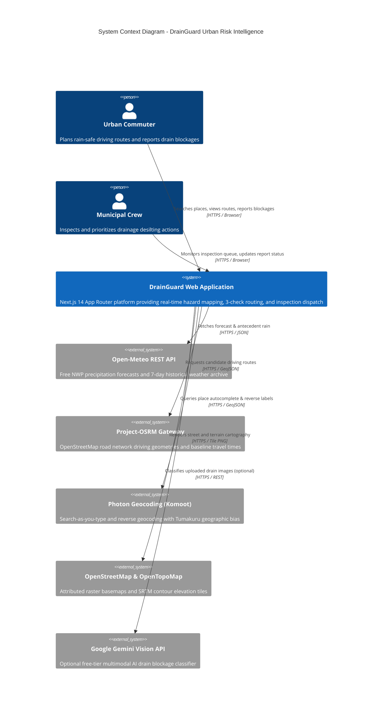
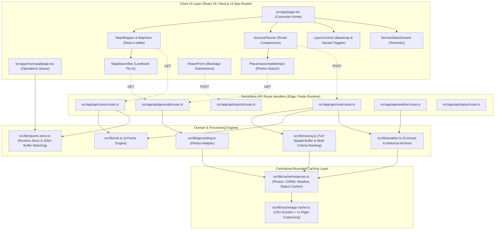
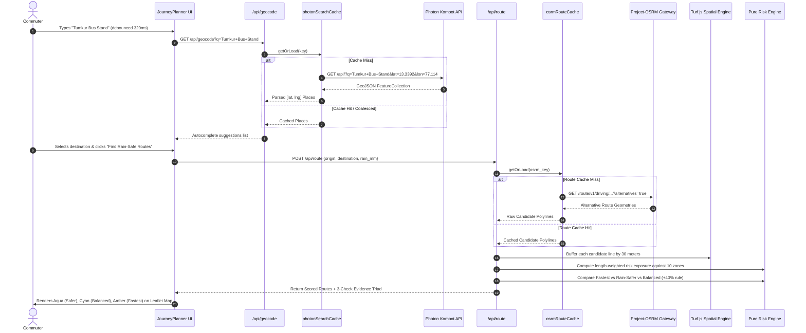

# DrainGuard System Architecture & Technical Specifications

## 1. Architectural Principles
DrainGuard is engineered around five strict architectural tenets:
1. **Explainable & Deterministic:** Risk calculations and route scoring run as pure mathematical functions without opaque machine-learning black boxes or non-reproducible outputs.
2. **Strict Zero-Paid-API Footprint:** Prohibits commercial subscriptions, credit-card requirements, or billing lock-in (Google Maps, TomTom, Mapbox paid tiers excluded).
3. **High-Performance Bounded Caching:** In-memory LRU caching with in-flight request deduplication protects public open-data endpoints from rate throttling.
4. **Data Honesty & Provenance:** Production never injects fake congestion lines, synthetic flood boundaries, or demonstration records into live responses.
5. **Map-First Responsive Design:** Mobile-first, tactile UI inspired by Namma Yatri's ergonomic bottom sheet and floating control layers.

---

## 2. High-Level System Architecture & C4 Container Model

---

## 3. Component Architecture & Next.js Module Organization

---

## 4. End-to-End Sequence Diagrams

### A. Place Autocomplete & Commuter Route Comparison

---

## 5. Architectural Technology Rationale

| Layer | Selected Technology | Evaluated Alternatives | Technical Rationale & Trade-off Justification |
| :--- | :--- | :--- | :--- |
| **Framework** | **Next.js 14 App Router + React 18** | Vite SPA, Remix, SvelteKit | Provides unified full-stack TypeScript API route handlers and React Server Components. Eliminates cross-origin CORS configuration and supports built-in server-side caching. |
| **Mapping Engine** | **Leaflet + React-Leaflet 4** | MapLibre GL, OpenLayers, Google Maps JS | Extremely lightweight bundle footprint (~40 KB gzip vs ~250 KB for MapLibre/Mapbox GL). Works reliably on mobile low-bandwidth devices without requiring WebGL 2 hardware acceleration. |
| **Geospatial Processing** | **Turf.js (@turf/turf 7)** | PostGIS server, JSTS, GDAL | Client/Node pure JavaScript computational geometry. Performs point-in-polygon tests and line buffering in $<10$ ms in-memory without requiring heavy database installations. |
| **Routing Provider** | **Project-OSRM Public Demo** | GraphHopper, Valhalla, Google Routes | Free public demo gateway built on OpenStreetMap road topologies. Returns true driving geometries with turn-by-turn distance and duration. |
| **Geocoding Adapter** | **Photon by Komoot** | OSM Nominatim, Mapbox Search, Google Places | Zero-cost open data (ODbL). Supports search-as-you-type and reverse geocoding with geographic bias. Strictly avoids violating OSM Nominatim's strict autocomplete ban. |
| **Caching Engine** | **Bounded In-Memory AppCache (LRU)** | Redis, Memcached, SQLite | Zero-dependency, single-process bounded memory storage. In-flight promise coalescing prevents "thundering herd" upstream calls without external hosting costs. |
