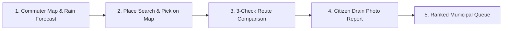

# DrainGuard Hackathon Demonstration & Judging Guide

## 1. 30-Second Elevator Pitch
> *"During heavy monsoon downpours, Indian commuters on two-wheelers get trapped in submerged underpasses because Google Maps shows roads as clear if vehicle volume is low. Meanwhile, city municipal corporations clear drain complaints in the order received, rather than by flood risk.*  
> *DrainGuard is an explainable, sensor-free waterlogging intelligence platform. It computes a 4-factor street hazard score, provides rain-safe navigation avoiding flooded sumps, and auto-generates an objective, risk-ranked inspection queue for municipal desilting crews—built entirely on a sustainable, zero-paid-API open data stack."*

---

## 2. 3-Minute Live Demonstration Walkthrough

### Step 1: Commuter Map-First Overview (0:00 – 0:45)
1. Open **`http://localhost:3000`**.
2. Point out the dark-mode Leaflet cartography centered on **Tumakuru, Karnataka**.
3. Toggle the top-right basemap switcher between **OSM Streets** and **OpenTopoMap SRTM Contours** to highlight the topographical elevation drop into the Amanikere Lake basin (~798m ASL).
4. Inspect the top weather banner showing the active 3-hour precipitation forecast from Open-Meteo.

### Step 2: Place Search & "Pick on Map" (0:45 – 1:30)
1. In the Journey Planner, click Starting Point and type *"Railway Station"* $\to$ Select *"Tumakuru Railway Station"*.
2. Click the **"Map"** button on Destination $\to$ Notice the top banner: *"Tap map to choose Destination"*.
3. Click near Gubbi Gate on the map $\to$ Resolves human-readable label $\to$ Click **Confirm**.

### Step 3: Multi-Criteria Route Comparison (1:30 – 2:15)
1. Click **"Find Rain-Safe Routes"**.
2. Explain the route cards:
   - **Fastest (Amber):** Direct path, but cuts directly through high-risk underpass sumps (Score 70/100).
   - **Rain-Safer (Aqua):** Safest path (Score 24/100), adding just 1 minute (+14%) to avoid flood zones.
3. Open the **"Geospatial Evidence Checks"** drawer:
   - *Check A:* Current & forecast rainfall rate.
   - *Check B:* Past 24h/72h antecedent saturation from Open-Meteo Historical Archive.
   - *Check C:* Honest baseline traffic feasibility (Zero-paid policy).

### Step 4: Citizen Report & Municipal Prioritization (2:15 – 3:00)
1. Click **"Report Issue"** in the top header $\to$ Select a drain blockage type (e.g. *Plastic*, Severity 3).
2. Submit report $\to$ Show instant zone risk recalculation.
3. Navigate to **`/municipal`** $\to$ Point out the **Risk-Ranked Desilting Queue**:
   - The clogged drain immediately surfaces at the top of the municipal dispatch list because of incoming rainfall.

---

## 3. Anticipated Judging Questions & Honest Answers

| Judge's Question | Honest, Grounded Answer |
| :--- | :--- |
| **"Do you have physical depth sensors deployed in the drains?"** | *"No, and that is a deliberate architectural feature. IoT water depth sensors cost thousands of dollars, get clogged with silt, and fail during severe storms. DrainGuard is a 100% sensor-free platform that correlates rainfall, terrain depressions, and civic reports."* |
| **"Is this a machine learning flood prediction model?"** | *"No. It is a mathematically transparent 4-factor heuristic risk index ($40\%$ rain, $25\%$ blockage, $20\%$ history, $15\%$ elevation). We deliberately avoided black-box ML so every score is 100% auditable and explainable to municipal engineers."* |
| **"Why don't you show live traffic congestion?"** | *"To maintain a strict Zero-Paid-API policy. Commercial traffic APIs like Google Maps Platform or TomTom require expensive subscriptions. We use OSRM baseline road network speeds and honestly disclose that live traffic is not connected."* |
