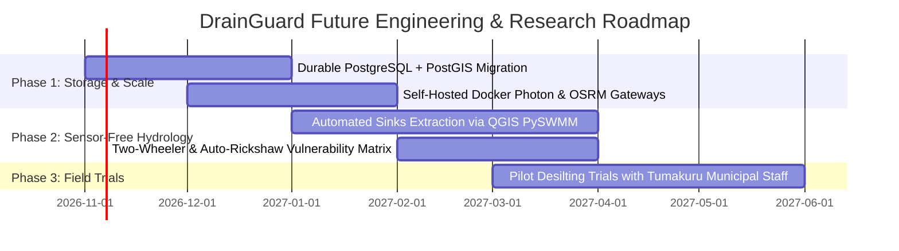

# Honest Technical Limitations and Future Research Agenda

## 1. Disclosed Technical Limitations

### A. Geospatial Data & Topographical Constraints
- **Absence of Authoritative Municipal GIS Shapefiles:** Tumakuru City Corporation (TCC) has not published official digital flood-risk polygons or underground stormwater drainage network blueprints as open data. The 10 zones in `src/data/zones.seed.json` are topographically grounded using OpenStreetMap waterbodies and SRTM elevation contours, but are **demonstration zones grounded in physical topography**, not certified flood insurance maps.
- **Micro-Topography vs. Macro-DEM:** The open-access SRTM Digital Elevation Model has an approximate ~30-meter horizontal resolution. Subtle curb-level micro-depressions (10–15 cm) that trap storm runoff cannot be resolved without high-resolution airborne LiDAR.

### B. Meteorological Forecasting & Spatial Resolution
- **NWP Atmospheric Grid vs. Street Water Depth:** Open-Meteo forecasts represent atmospheric precipitation across an ~11-kilometer grid cell. Rain volume cannot be translated directly into street water depth without a localized run-off hydrograph.
- **Localized Cloudbursts:** Convective thunderstorms in tropical India frequently exhibit extreme localized variance over 1–2 kilometers that regional numerical weather models may partially smooth out.

### C. Traffic Telemetry & Free Open-Data Constraints
- **Zero Live Vehicular Congestion:** Commercial traffic APIs (Google Maps Platform, TomTom, HERE) are excluded to maintain 100% compliance with our Zero-Paid-API policy. Travel times represent OSRM baseline free-flow road estimates.

### D. Data Storage & Persistence
- **Process-Local Memory Store:** In the current MVP deployment, citizen reports and cache entries reside in-memory within the Node.js process. Restarting the server resets the runtime state. Durable multi-user production requires an external PostgreSQL database.

---

## 2. Prioritized Future Research Agenda

1. **Durable Database Integration:** Migrate `src/lib/reports-store.ts` to an open-source, self-hosted PostgreSQL 16 + PostGIS instance to provide permanent civic report storage, spatial indexing, and audit logging.
2. **Dedicated Self-Hosted Gateway Containers:** Deploy containerized Docker instances of Komoot Photon and Project-OSRM for enterprise high-concurrency workloads.
3. **Automated Depression Sinks from High-Resolution DTMs:** Integrate QGIS flow-direction tools to systematically generate micro-catchment polygons across Indian tier-2 municipalities.
4. **Calibrated Two-Wheeler Vulnerability Thresholds:** Partner with academic transportation researchers to calibrate non-linear risk curves for Indian two-wheelers and auto-rickshaws.
