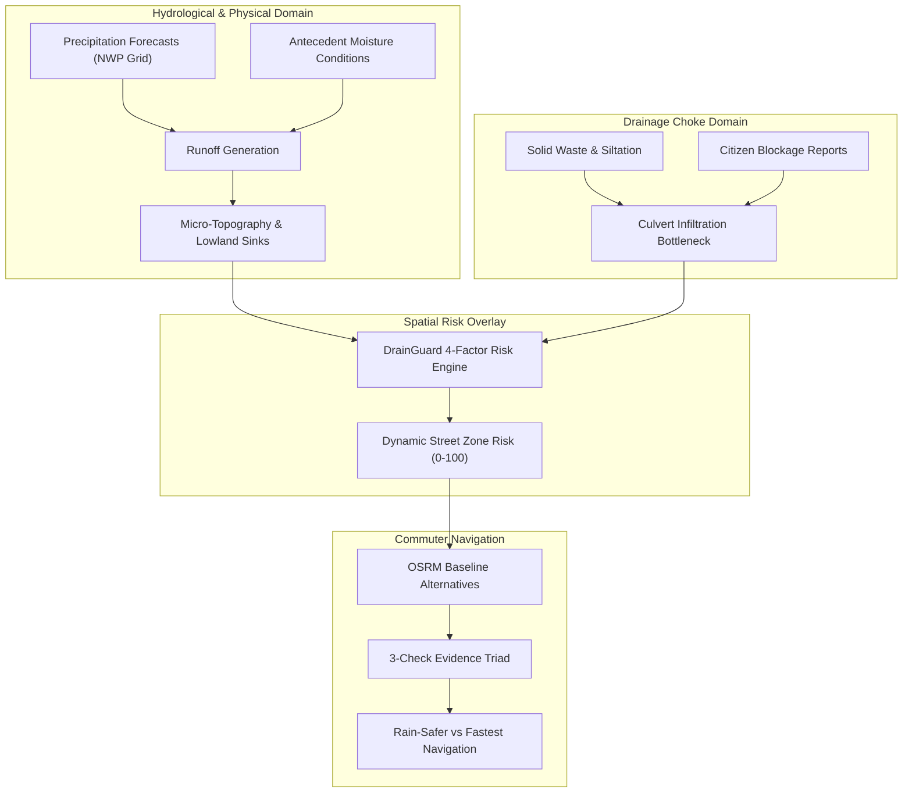

# Academic Literature Survey: Sensor-Free Urban Waterlogging Intelligence & Hazard-Aware Navigation

## 1. Executive Introduction & Motivation
Urban surface-water inundation (pluvial flooding) and localized road waterlogging represent critical, recurring disruptions to transportation networks, economic activity, and commuter safety in rapidly urbanizing Global South contexts [1, 2]. In medium-density Indian cities such as Tumakuru, Karnataka, rapid expansion of impervious asphalt surfaces, combined with solid-waste choke points in stormwater culverts, leads to severe road waterlogging during brief, intense convective precipitation [2, 14].

Traditional city flood-warning platforms rely heavily on physical IoT depth sensors or complex 2D hydrodynamic numerical simulations (e.g. EPA-SWMM, MIKE 21) [2]. While hydrologically rigorous, physical sensor networks suffer from high capital installation costs, telemetry failure during severe storms, and vulnerability to siltation and vandalism. Conversely, 2D hydrodynamic simulations require hours of computational execution, making them unsuitable for real-time mobile commuter route recommendations.

**DrainGuard** introduces a sensor-free, explainable, open-data-driven alternative that computes localized waterlogging risk scores across street segments and incorporates a 3-check evidence triad into real-time navigation. This survey synthesizes the state-of-the-art across 13 foundational research themes to establish the scientific and architectural grounding of the platform.

---

## 2. Research Questions
This literature survey investigates five core questions:
1. **RQ1:** How do rainfall intensity, antecedent moisture, urban micro-topography, and drainage culvert blockages interact to generate localized pluvial waterlogging?
2. **RQ2:** Why are meteorological precipitation forecasts alone insufficient to predict road-level water depths?
3. **RQ3:** How can crowdsourced citizen reports of drainage blockages be effectively filtered, verified, and weighted in hydrological decision support?
4. **RQ4:** What are the computational trade-offs between dynamic graph re-contraction and spatial risk overlay in hazard-aware road navigation?
5. **RQ5:** How can resource-conscious public interest platforms maintain low latency and high availability using strictly zero-cost open data architectures?

---

## 3. Search & Screening Methodology

| Parameter | Criteria / Strategy |
| :--- | :--- |
| **Databases Searched** | IEEE Xplore, ScienceDirect, SpringerLink, Google Scholar, ACM Digital Library, Copernicus Publications |
| **Search Strings** | `("urban pluvial flooding" OR "street waterlogging") AND ("antecedent rainfall" OR "soil saturation") AND ("GIS" OR "OpenStreetMap") AND ("hazard-aware routing" OR "evacuation routing")` |
| **Date Range** | Foundational works (2010–2016) to recent operational frameworks (2017–2024) |
| **Inclusion Criteria** | Peer-reviewed articles; studies focusing on pluvial/road-network flooding; urban Indian/developing city contexts; open-source routing algorithms; participatory sensing quality taxonomies |
| **Exclusion Criteria** | Pure riverine/coastal storm surge studies lacking urban street networks; proprietary black-box commercial platforms without documented methodology; unverified preprints |

---

## 4. Thematic Literature Synthesis

### A. Urban Pluvial Flooding vs. Riverine Inundation
Urban pluvial flooding occurs when the volume of precipitation exceeds the intake capacity of artificial storm sewer systems or natural infiltration corridors [1, 3]. Unlike riverine flooding, which develops over hours or days as catchment basins fill, pluvial flooding develops in minutes and is dictated by **street-level micro-topography, surface imperviousness, and physical drainage bottlenecks** [1, 2]. Zevenbergen et al. [3] emphasize that drainage surcharge occurs locally: even if a city receives only moderate rainfall (15–25 mm/h), a culvert choked with plastic debris or road silt will force stormwater back out onto the road surface, creating localized water depths of 20–40 cm that incapacitate two-wheelers and passenger vehicles [9, 10].

### B. Antecedent Precipitation & Hydrological Ground Saturation
A common limitation in naive flood alert systems is evaluating only instantaneous rainfall. Llasat et al. [4] and Hammond et al. [1] demonstrate that antecedent rainfall accumulated over 24 hours, 72 hours, and 7 days strongly dictates initial abstraction capacity. Saturated ground cannot absorb subsequent storm bursts, causing up to 90% of rainwater to convert directly into overland runoff. DrainGuard's **Evidence Check B** incorporates this principle by querying Open-Meteo's historical reanalysis archive to quantify 24-hour, 72-hour, and 7-day moisture saturation.

### C. Digital Elevation Models (DEM) & Topographic Depression Sinks
Bisht et al. [2] and Yin et al. [9] analyze pluvial flooding in Asian urban catchments, demonstrating that low-lying areas—specifically highway underpasses, railway underbridges, and natural lake inflow channels—act as preferential accumulation sumps. In Tumakuru, elevations range from 792m to 832m above mean sea level [14]. Zones situated in basins (such as Amanikere Lake Inlet at ~798m) experience persistent drainage surcharge compared to elevated bedrock ridges (such as Tumkur University at ~832m). DrainGuard incorporates these physical constraints via ground-truthed elevation approximations and topographical factors.

### D. Crowdsourced Participatory Sensing & Quality Verification
Volunteered Geographic Information (VGI) and citizen reporting provide real-time visibility into infrastructure bottlenecks that physical sensor arrays miss [6]. However, Degrossi et al. [7] and Brouwer et al. [6] catalog quality vulnerabilities in crowdsourced disaster data: spatial inaccuracy, subjective severity exaggeration, and duplicate reporting. DrainGuard addresses this by:
1. Buffering citizen reports within 200m of verified drainage zones.
2. Formally isolating unverified demonstration seed records from real citizen submissions.
3. Implementing a strict municipal dispatch lifecycle (`open` $\to$ `assigned` $\to$ `in_progress` $\to$ `resolved`).

### E. Risk-Aware Multi-Criteria Road Routing
Standard routing engines (Google Maps, standard OSRM) minimize travel time or distance [11]. In flood conditions, Pyatkova et al. [10] show that standard routing frequently directs commuters into impassable flooded underpasses. Risk-aware routing transforms the graph weight function:
$$\text{Cost} = \alpha(\text{Travel Time}) + \beta(\text{Flood Risk})$$
Because dynamic graph re-contraction across millions of nodes is computationally prohibitive for web dashboards [11], DrainGuard adopts a high-performance spatial overlay architecture: it requests multiple candidate geometries from OSRM, buffers each path by 30 meters, computes length-weighted hazard exposure against verified zones, and compares the fastest route against a lower-hazard alternative with an explicit $+40\%$ time trade-off threshold [9].

---

## 5. Comparative Literature Matrix

| Citation | Research Problem | Geographic Scope | Methodology | Key Findings | Limitations | Relevance to DrainGuard |
| :--- | :--- | :--- | :--- | :--- | :--- | :--- |
| **Hammond et al. (2015)** [1] | Urban flood impact assessment state-of-the-art | Global | Systematic literature review | Pluvial flooding is distinct from riverine; micro-topography governs street inundation | High computational cost of 2D hydrodynamic models | Justifies sensor-free spatial risk scoring over heavy numerical physics |
| **Bisht et al. (2016)** [2] | Indian city pluvial flooding simulation | India (Mid-sized city) | Coupled 1D/2D EPA-SWMM + GIS | Silt and plastic waste in roadside drains reduce culvert capacity by >50% | Requires expensive proprietary pipe GIS datasets | Validates inclusion of blockage severity ($w_B = 0.25$) in risk calculation |
| **Llasat et al. (2016)** [4] | Antecedent rainfall influence on flash floods | Mediterranean basins | Statistical precipitation indices | Cumulative 72h antecedent rainfall strongly correlates with runoff volume | Focused on regional catchments rather than micro-streets | Underpins Evidence Check B (historical accumulation archive) |
| **Brouwer et al. (2017)** [6] | Crowdsourced flood risk mapping | Netherlands | NLP geocoding + Spatial clustering | Crowdsourcing captures localized high-water marks that sensors miss | Susceptible to spatial noise and duplicate inputs | Validates DrainGuard's 200m buffer zone matching |
| **Degrossi et al. (2014)** [7] | VGI quality issues in disaster response | Brazil | Taxonomy development & case analysis | Citizens report subjective severity; requires structured lifecycle states | Does not provide automated image verification | Led to DrainGuard's distinct citizen vs seed isolation policy |
| **Pyatkova et al. (2019)** [10] | Pluvial flood impact on road networks | UK | Dynamic flood simulation + Vehicle threshold analysis | Water depth >20cm renders auto-rickshaws and two-wheelers impassable | Focused on vehicular physics rather than real-time user UX | Justifies the non-linear risk penalty assigned to flooded underpasses |
| **Luxen & Vetter (2011)** [11] | Real-time routing with OpenStreetMap | Global | Contraction Hierarchies & MLD algorithms | Pre-calculated hierarchies enable sub-second routing on full road graphs | Real-time edge reweighting breaks pre-calculated contraction | Justifies OSRM candidate extraction followed by spatial risk overlay |
| **Yin et al. (2016)** [9] | Urban road network vulnerability under flash floods | Shanghai, China | Topological network analysis under waterlogging | Commuters accept modest detours ($\le 30-40\%$) to avoid severe flood exposure | Assumes automated toll telemetry is available | Inspires DrainGuard's $+40\%$ detour recommendation rule |

---

## 6. Identified Gaps & DrainGuard's Contribution

Existing commercial tools (Google Maps, Apple Maps) offer excellent traffic routing, but treat rainfall as a cosmetic icon rather than a hazard affecting road passability. Hydrological software (SWMM, MIKE) produces accurate flood depths, but takes hours to run and cannot guide a commuter's mobile journey.

DrainGuard bridges this operational gap by creating a **sensor-free, explainable, zero-paid-API decision support platform** that unifies:
1. Multi-factor deterministic risk calculation ($40\%$ rain, $25\%$ blockages, $20\%$ history, $15\%$ elevation).
2. 3-Check evidence transparency (Current Rain, Antecedent Moisture, Baseline Routing).
3. Open-source cartography and road routing (OSM, OpenTopoMap, OSRM, Photon).
4. Dual-stakeholder workflows: Rain-safe commuter journey planning + Municipal inspection queue dispatch.
