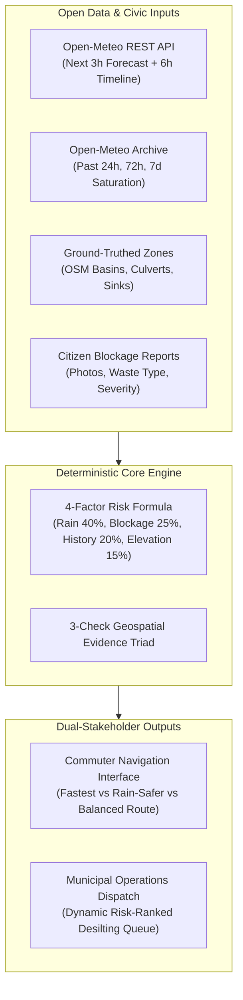

# DrainGuard: Project Overview & Scientific Positioning

## 1. Executive Summary
**DrainGuard** is an explainable, sensor-free, rain-aware urban waterlogging intelligence and multi-criteria navigation platform tailored for Indian urban centers. Demonstrated across the municipality of **Tumakuru, Karnataka**, DrainGuard unifies live meteorological precipitation forecasts, 7-day antecedent ground saturation archives, ground-truthed topographical basin features, and crowdsourced drainage blockage reports into actionable, transparent decision support for two critical stakeholders:
1. **Urban Commuters:** Seeking rain-safe driving routes that steer clear of submerged underpasses and waterlogged road sumps.
2. **Municipal Operations Teams:** Needing an objective, risk-ranked inspection and desilting queue to clear critical stormwater culverts before heavy cloudbursts cause inundation.

---

## 2. Core Value Proposition & System Identity

### What DrainGuard Is:
- A **sensor-free heuristic intelligence platform** that evaluates waterlogging vulnerability using open geographic and meteorological data.
- An **explainable navigation assistant** that provides transparent route trade-offs (e.g. *"Adding 3 min (+14%) avoids SS Puram lowlands & Gubbi Gate sump"*).
- A **public-interest, sustainable software architecture** running on a strictly zero-paid-API footprint (OpenStreetMap, OpenTopoMap, OSRM, Photon, Open-Meteo).

### What DrainGuard Is NOT:
- DrainGuard is **not a numerical 2D hydrodynamic flood solver** (such as SWMM or MIKE). It does not compute physical fluid velocities or laminar boundary layer equations.
- DrainGuard is **not an official disaster early-warning system** issued by the Central Water Commission (CWC) or the India Meteorological Department (IMD).
- DrainGuard **does not measure real-time road water depths in centimeters**, as physical depth sensors are not deployed.

---

## 3. The 3-Check Geospatial Evidence Triad

Every route recommendation in DrainGuard is validated against three distinct, verifiable checks:

### Evidence Check A — Current and Forecast Rainfall
- **Data Source:** Open-Meteo NWP Forecast Grid (~11 km resolution, ECMWF / GFS ensemble).
- **Parameters:** Instantaneous precipitation rate (mm/h), cumulative next-3-hour forecast, and 6-hour hourly precipitation probability.
- **Commuter Transparency:** Explicitly discloses that rainfall estimates represent atmospheric precipitation over the Tumakuru grid, not confirmed standing water on the pavement.

### Evidence Check B — Antecedent Moisture, History & Grounding
- **Data Source:** Open-Meteo Historical Weather Archive API.
- **Parameters:** Cumulative rainfall over the preceding **24 hours**, **72 hours**, and **7 days**.
- **Topographical Grounding:** Correlates ground moisture saturation against 10 ground-truthed drainage corridors and waterbody basins (Amanikere Lake basin, B.H. Road culvert bottleneck, railway underpasses).
- **Honest Data Disclosure:** Authoritative municipal GIS inundation maps are not published as open data for Tumakuru. The platform explicitly communicates `historical_flood_records_status: "unavailable_locally"` rather than inventing artificial historical boundaries.

### Evidence Check C — Route Feasibility & Zero-Cost Routing
- **Data Source:** Project-OSRM Driving Router on the OpenStreetMap road network.
- **Travel Time Telemetry:** Uses baseline free-flow road geometries and speed profiles.
- **Zero-Paid-API Policy Enforcement:** Live vehicular congestion APIs (Google Maps Platform, TomTom, HERE) are excluded to ensure zero commercial billing. The interface clearly discloses: `Baseline OSRM speed (No live congestion fees)`.

---

## 4. Dual-Stakeholder Workflows

### 1. Commuter Navigation Workflow
- **Search or Tap:** Commuters enter their starting point and destination using Photon search-as-you-type autocomplete or tap directly on the Leaflet map in dedicated "Pick on Map" mode.
- **Route Options:** Generates **Rain-Safer** (Aqua polyline), **Balanced** (Cyan polyline), and **Fastest** (Amber dashed polyline).
- **Safe Recommendation Logic:** If the safest route adds $\le 40\%$ driving time over the fastest route, DrainGuard recommends the rain-safer detour to protect commuters and two-wheeler riders from flood hazards.

### 2. Municipal Operations Workflow
- **Civic Reporting:** Citizens submit photographs of drain blockages, categorizing waste types (plastic packaging, construction debris, silt sediment, organic waste) and severity ($1-3$).
- **Dynamic Prioritization:** The municipal dashboard at `/municipal` ingests all active reports, correlates them with incoming rainfall forecasts and zone risk scores, and re-orders the queue so maintenance crews clear the most dangerous choke points first.
