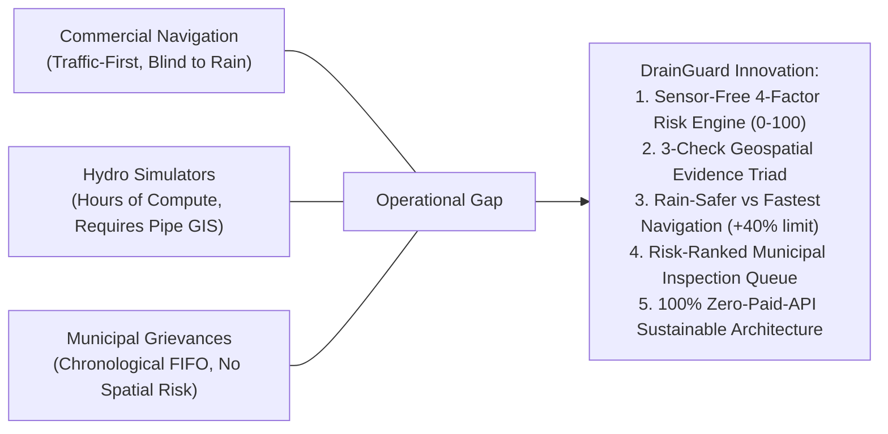

# Related Work and Systematic Gap Analysis

## 1. Problem Statement: Does a Solution Already Exist?
Urban waterlogging poses two distinct operational problems:
1. **The Commuter Problem:** Commuters cannot tell whether a route is passable during intense rainfall until they reach a submerged street or flooded underpass.
2. **The Municipal Problem:** Urban local bodies (ULBs) lack a data-driven, risk-ranked queue to dispatch desilting and drain clearance crews before localized waterlogging escalates into city-wide gridlock.

To answer whether an existing solution already resolves this, we evaluate eight major categories of existing platforms against 11 rigorous technical and operational criteria.

---

## 2. Systematic Evaluation Matrix

| Platform Category | Representative Systems | Geographic Resolution | Street-Level Flood Applicability | Flood History & Antecedent Rain | Explainable Risk Metric | Integrated Route Navigation | Citizen Blockage Reporting | Municipal Queue Ranking | Sensor-Free Deployment | Zero-Cost Architecture |
| :--- | :--- | :---: | :---: | :---: | :---: | :---: | :---: | :---: | :---: | :---: |
| **Commercial Navigation** | Google Maps, Apple Maps, Waze | High | Not Supported | Not Supported | Not Supported | Fastest / Traffic-Only | Partial (Hazard pins only) | Not Supported | High (GPS Telemetry) | Prohibitive Commercial Billing |
| **Consumer Weather Apps** | AccuWeather, The Weather Channel | Low (~10-25 km) | Not Supported | Partial (Past 24h only) | Not Supported | Not Supported | Not Supported | Not Supported | High (NWP Grid) | Freemium / Ad-Supported |
| **Flood Early Warning Systems** | CWC Flood Forecast, GloFAS | Regional / Basin | Riverine Only (Not pluvial) | High (River gauges) | Partial (Water level) | Not Supported | Not Supported | High (Disaster authority) | Low (Requires physical gauges) | Government Funded |
| **Hydrodynamic Simulators** | EPA-SWMM, MIKE 21, HEC-RAS | Street / Pipe | High | High | Complex Hydraulic Output | Not Supported | Not Supported | Offline Planning Only | Low (Requires pipe GIS) | Expensive Proprietary Licenses |
| **Municipal Grievance Portals** | CPGRAMS, City Helpdesks | Ward / Landmark | Partial (Text complaints) | Not Supported | Not Supported | Not Supported | High (Text form) | FIFO Only (No risk rank) | High | Variable Municipal Budget |
| **Smart City ICCC Dashboards** | Smart City Command Centers | Ward | Partial | Partial | Varies (Often proprietary) | Not Supported | Partial (Helpline integration) | Partial | Low (Requires CCTV/IoT) | Multi-Crore Infrastructure |
| **Academic Routing Prototypes** | Literature Models [9, 10] | Street | High | High | High | High | Not Supported | Not Supported | Offline Only | Open Academic Models |
| **DrainGuard Platform** | **DrainGuard MVP** | **Street Zone (~30m buffer)** | **High (10 grounded zones)** | **High (24h, 72h, 7d Open Archive)** | **High (4-factor transparent 0-100)** | **High (Fastest vs Rain-Safer vs Balanced)** | **High (Photo upload + Category + Severity)** | **High (Risk-ranked inspection queue)** | **100% Sensor-Free** | **100% Free / Open-Data Stack** |

---

## 3. Deep-Dive Comparative Breakdown

### A. General-Purpose Navigation Engines (Google Maps, Waze)
- **Strengths:** Global map coverage, exceptional vehicular congestion tracking, sub-meter road geometries.
- **Why they fail for flood intelligence:**
  1. Commercial navigation is optimized strictly for travel time or distance.
  2. They do not ingest hourly precipitation forecasts, antecedent saturation, or drain choke points.
  3. A street flooded with 25 cm of water appears "clear" with green free-flow speeds on Google Maps if vehicle volume is low, misleading commuters directly into hazardous waterlogging.
  4. Google Maps Platform requires billing accounts and credit cards, making it unsustainable for public civic infrastructure.

### B. Hydrodynamic Simulators (EPA-SWMM, MIKE Urban)
- **Strengths:** Physically exact fluid dynamics, pipe flow velocity, pressurized conduit surcharge modeling.
- **Why they fail for commuter decision support:**
  1. Execution times take hours or days to converge, making real-time mobile routing impossible.
  2. They require comprehensive GIS inventories of underground pipe diameters, slope gradients, invert elevations, and manhole locations—data that is non-existent, unreleased, or decades out-of-date in tier-2 Indian cities like Tumakuru.

### C. Municipal Grievance Portals (CPGRAMS, Urban Local Body Helpdesks)
- **Strengths:** Legally recognized citizen submission channels.
- **Why they fail for proactive flood mitigation:**
  1. Tickets are processed in First-In-First-Out (FIFO) chronological order, regardless of hydrological severity.
  2. A complaint regarding a minor residential ditch is treated with the same urgency as a choked arterial culvert that threatens an entire national highway corridor.
  3. They lack spatial map overlays and fail to correlate complaints with imminent precipitation forecasts.

---

## 4. The Specific Research & Engineering Gap DrainGuard Solves

DrainGuard addresses the **unresolved practical intersection**:
1. **Explainable Deterministic Heuristics:** Computes a mathematically transparent $0-100$ street risk score in $<5$ milliseconds, without expensive cloud GPU clusters or proprietary pipe datasets.
2. **Multi-Criteria Navigation:** Leverages OSRM on OpenStreetMap road grids to extract alternative driving paths, buffering them by 30 meters to compute length-weighted hazard exposure.
3. **Dual-Stakeholder Cohesion:** The same civic blockage report uploaded by a citizen immediately updates the road hazard score for commuters AND surfaces at the top of the municipal desilting queue.
4. **Honest Data Transparency:** Refuses to fabricate fake congestion lines or simulate unverified flood boundaries. Explicitly reports data provenance and limitations.
