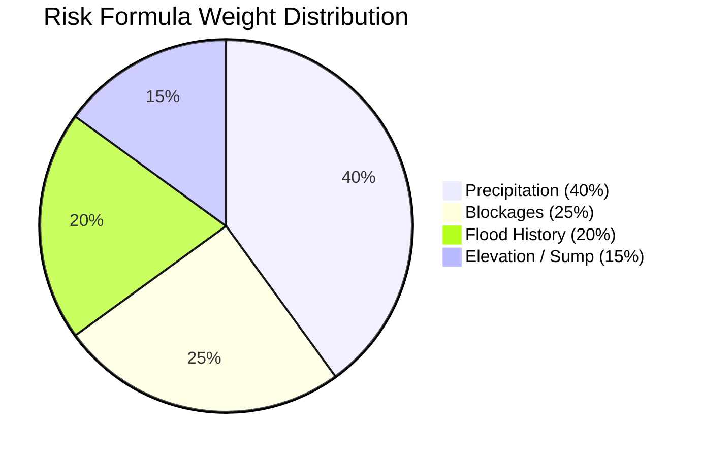

# Mathematical Methodology & Deterministic Risk Engine

## 1. Overview and Formal Objective
The DrainGuard Risk Engine (`src/lib/risk.ts`) evaluates localized urban waterlogging hazard for discrete street segments and hydrological micro-zones. It executes as a **pure mathematical function in TypeScript**, guaranteeing that identical inputs always yield identical outputs.

### Formal Nature of the Score
The resulting risk score ($R \in [0, 100]$) is an **explainable multi-factor heuristic risk index**. It is:
- **NOT** an empirical probability ($P \in [0, 1]$) of inundation.
- **NOT** an output of a differential Navier-Stokes 2D hydrodynamic solver.
- **NOT** an official flood warning issued by the Central Water Commission (CWC).

---

## 2. Mathematical Formulation

The zone risk score $R$ is formulated as a linear combination of four normalized sub-scores:

$$R = \text{clamp}_{[0, 100]} \left( w_R \cdot S_{\text{rain}} + w_B \cdot S_{\text{blockage}} + w_H \cdot S_{\text{history}} + w_E \cdot S_{\text{elevation}} \right)$$

Where the empirical weights sum to unity:
$$w_R = 0.40, \quad w_B = 0.25, \quad w_H = 0.20, \quad w_E = 0.15 \implies \sum w = 1.00$$

---

## 3. Sub-Score Derivations

### A. Rainfall Sub-Score ($S_{\text{rain}}$)
Derived from the 3-hour cumulative precipitation forecast ($P_{\text{rain}}$, in mm):
$$S_{\text{rain}} = \text{clamp}_{[0, 100]} \left( \frac{P_{\text{rain}}}{60.0} \times 100 \right)$$
*Normalization basis:* 60 mm of rainfall over a 3-hour window represents an intense convective cloudburst in southern peninsular India [2], which saturates typical urban roadside storm canals.

### B. Blockage Sub-Score ($S_{\text{blockage}}$)
Aggregates citizen and verified municipal reports associated with the zone:
$$S_{\text{blockage}} = \text{clamp}_{[0, 100]} \left( \sum_{i=1}^{N} \text{SeverityWeight}_i \times \text{StatusWeight}_i \right)$$

1. **Severity Weights ($\text{Severity} \in \{1, 2, 3\}$):**
   - Level 1 (Minor silt / partial leaf litter): $+15$ pts
   - Level 2 (Dense road silt / construction gravel): $+30$ pts
   - Level 3 (Total choke / plastic refuse / culvert collapse): $+50$ pts

2. **Status Multipliers:**
   - Status `open`: $1.0$ (Full active hazard impact)
   - Status `assigned`: $0.8$ (Dispatch initiated; physical obstruction remains)
   - Status `in_progress`: $0.5$ (Crews on-site; flow partially restored)
   - Status `resolved`: $0.0$ (Cleared; zero contribution)

### C. Historical Flood Evidence Sub-Score ($S_{\text{history}}$)
$$S_{\text{history}} = H_{\text{factor}} \times 100$$
Where $H_{\text{factor}} \in [0.0, 1.0]$ is grounded in localized historical drainage bottlenecks (e.g. railway underpasses and lake inflows carry $H_{\text{factor}} \ge 0.80$, while elevated bedrock ridges carry $H_{\text{factor}} \le 0.10$).

### D. Topographical Sump Sub-Score ($S_{\text{elevation}}$)
$$S_{\text{elevation}} = E_{\text{factor}} \times 100$$
Where $E_{\text{factor}} \in [0.0, 1.0]$ reflects relative depression depth below the surrounding watershed (e.g., Amanikere lake inlet at 798m elevation carries $E_{\text{factor}} = 0.85$, while elevated ridges at 832m carry $E_{\text{factor}} = 0.05$).

---

## 4. Risk Classification Thresholds

| Risk Score ($R$) | Hazard Level | UI Visual Token | Operational Interpretation |
| :---: | :---: | :---: | :--- |
| **0 – 29** | `Low` | Emerald Green (`#22C55E`) | Normal urban conditions; well-drained road surface. |
| **30 – 59** | `Medium` | Amber Yellow (`#F5B942`) | Minor gutter pooling; caution recommended for two-wheelers. |
| **60 – 79** | `High` | Hazard Orange (`#F97316`) | Substantial waterlogging; potential vehicle stall at underpasses. |
| **80 – 100** | `Severe` | Crimson Red (`#EF4444`) | Critical street inundation; desilting crew priority dispatch. |

---

## 5. Worked Calculation Examples

### Example 1: Critical Underpass During Cloudburst
- **Location:** Tumakuru Railway Underbridge (`Z03`, Sump Elevation 794m)
- **Inputs:** Forecast Rain = $45\text{ mm}$, 1 Open Report (Severity 3, Plastic choke), $H_{\text{factor}} = 0.80$, $E_{\text{factor}} = 0.75$.
- **Step-by-step:**
  1. $S_{\text{rain}} = \min(100, \frac{45}{60} \times 100) = 75.0$
  2. $S_{\text{blockage}} = 50 \times 1.0 = 50.0$
  3. $S_{\text{history}} = 0.80 \times 100 = 80.0$
  4. $S_{\text{elevation}} = 0.75 \times 100 = 75.0$
  5. $R = 0.40(75) + 0.25(50) + 0.20(80) + 0.15(75) = 30.0 + 12.5 + 16.0 + 11.25 = \mathbf{69.75} \to \mathbf{70}$ (`High Hazard`)

### Example 2: Elevated Ridge Under Normal Rainfall
- **Location:** Tumkur University Ridge (`Z09`, Ridge Elevation 832m)
- **Inputs:** Forecast Rain = $10\text{ mm}$, 0 Blockage Reports, $H_{\text{factor}} = 0.10$, $E_{\text{factor}} = 0.05$.
- **Step-by-step:**
  1. $S_{\text{rain}} = \frac{10}{60} \times 100 = 16.67$
  2. $S_{\text{blockage}} = 0.0$
  3. $S_{\text{history}} = 10.0$
  4. $S_{\text{elevation}} = 5.0$
  5. $R = 0.40(16.67) + 0.25(0) + 0.20(10) + 0.15(5) = 6.67 + 0 + 2.0 + 0.75 = \mathbf{9.42} \to \mathbf{9}$ (`Low Hazard`)

---

## 6. Route Hazard Scoring & Multi-Criteria Ranking

To evaluate a full route polyline:
1. Turf.js buffers the candidate driving polyline by **30 meters** ($0.03\text{ km}$).
2. Computes the spatial intersection length $L_j$ through each hazard zone $j$.
3. Calculates the length-weighted route hazard score:
   $$R_{\text{route}} = \text{clamp}_{[0, 100]} \left( \frac{\sum (R_j \times L_j)}{L_{\text{total}}} \right)$$
4. **The $+40\%$ Time Trade-Off Rule:**
   $$\text{Recommend } \text{Safest} \iff \frac{T_{\text{safest}} - T_{\text{fastest}}}{T_{\text{fastest}}} \le 0.40$$
   If the rain-safer detour adds $\le 40\%$ travel time over the fastest path, DrainGuard recommends the safer route to protect commuters from severe waterlogging.
