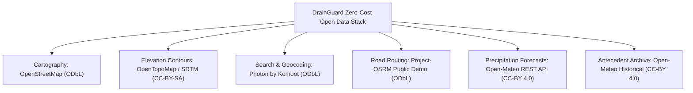

# Zero-Paid-API Policy, Open-Data Licensing & Sustainability

## 1. Zero-Paid-API Commitment
DrainGuard is architected under an unyielding public-interest constraint: **Zero Commercial API Subscriptions**. The platform does not require credit card registrations, cloud trial accounts, or metered billing tiers.

---

## 2. Dependency & Licensing Matrix

| Service / Component | Role in DrainGuard | License / Usage Terms | API Key Needed? | Commercial Cost | Operational Policy Compliance |
| :--- | :--- | :--- | :---: | :---: | :--- |
| **OpenStreetMap** | Street & waterbody spatial geometry | Open Database License (ODbL 1.0) | None | Free / Open Data | Attributed on all basemap views (`© OpenStreetMap contributors`) |
| **OpenTopoMap** | Topographical relief & SRTM contours | Creative Commons Attribution-ShareAlike 3.0 | None | Free / Open Data | Dual attribution displayed (`OpenTopoMap (CC-BY-SA)`) |
| **Photon (Komoot)** | Search-as-you-type & reverse geocoding | Apache 2.0 / ODbL open data | None | Free / Zero-cost public demo | Centrally cached with 320ms debounce; Nominatim autocomplete strictly prohibited |
| **Project-OSRM** | Driving routing & distance calculations | Simplified BSD License / ODbL | None | Free / Zero-cost public gateway | 8-min route cache prevents hammering the shared public gateway |
| **Open-Meteo** | Weather forecast & historical saturation | CC-BY 4.0 (Non-commercial open access) | None | Free open access | Requests bounded and cached; spatial grid limits disclosed |
| **Google Gemini Vision** | Optional AI drain blockage photo scan | Google AI Studio Free Tier | Optional (`GEMINI_API_KEY`) | Free tier available | Deterministic rule-based heuristic fallback active if key is omitted |

---

## 3. Sustainability & Self-Hosting Roadmap
While public gateways (Photon demo, OSRM public gateway, Open-Meteo) allow DrainGuard to operate with zero infrastructure budget, enterprise city-scale deployments should migrate to **self-hosted open-source instances**:
- **Self-Hosted OSRM:** Can be containerized via Docker on a standard 4-core, 8GB RAM Linux VPS using India OSM extract (`karnataka-latest.osm.pbf`).
- **Self-Hosted Photon:** Can be run via Docker on OpenSearch to support tens of thousands of simultaneous search queries with zero external rate limits.
- **Durable Database:** An open-source PostgreSQL + PostGIS instance can be connected to replace the current in-memory report store without software license fees.
